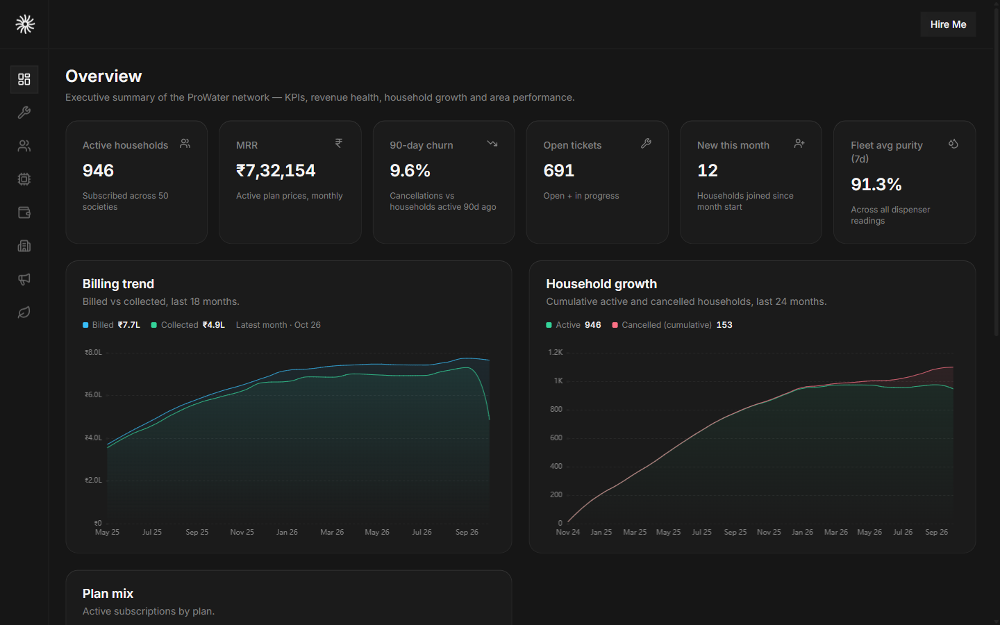
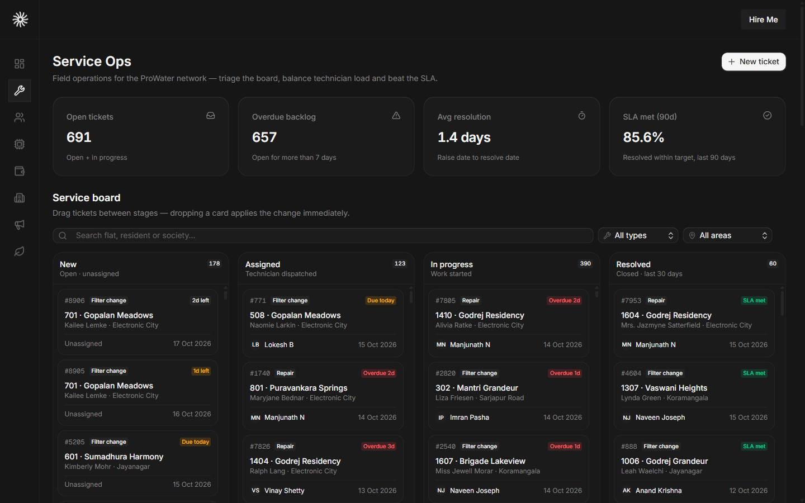
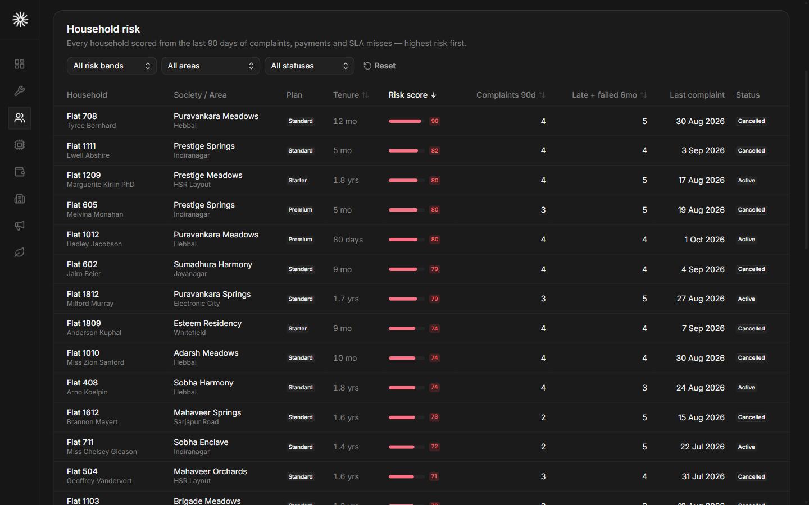

# ProWater — Ops & Monitoring Dashboard

An internal operations dashboard for **ProWater**, a fictional piped RO drinking-water
subscription service in Bangalore. It models the full business chain — societies →
households → subscriptions → IoT dispensers → field service → complaints → billing —
across 24 months of simulated history, and answers the questions an ops team actually has:

- **Where is revenue leaking?** churn risk, failed payments, collections
- **What is about to break?** predictive maintenance derived from live TDS/purity telemetry
- **Where is field capacity strained?** SLA misses, technician load, area imbalance
- **Where should we expand?** penetration by area and society, plus a working sales funnel

One Postgres schema behind a strictly typed tRPC API — no mock JSON in the client, no REST
endpoints for data.

> **Public demo — no auth, on purpose.** Every page is open. Mutations (drag a kanban card,
> mark a payment paid, add or resolve a complaint, recompute risk) are live and shared by all
> visitors. Re-seeding the database is the reset button — see [Local setup](#local-setup).

## Screenshots







## Architecture

```
Browser (React 19 client components)
  │   TanStack Query hooks per feature — useSuspenseQuery / mutationOptions
  │   tRPC v11 over HTTP (SuperJSON transport, Zod-validated inputs)
  ▼
Next.js 16 App Router
  │   Server components run tRPC on the server: batchPrefetch → HydrateClient
  │   per-route <Suspense> skeletons shaped like the real content
  │   per-route error boundaries with retry, mutations toast on success/error
  │   tRPC routers (thin) → feature modules in src/features/<name>
  ▼
Drizzle ORM v1  (typed queries in src/db/queries)
  │   @neondatabase/serverless HTTP driver
  ▼
Neon Postgres  (12 tables, indexed for the dashboard's access patterns)
```

Every route is a server component that prefetches its queries in one batch, hydrates the
client, and streams sections as their data resolves. Client pages never fetch data directly —
they call the same tRPC procedures through feature hooks, so server prefetch and client
refetch share one cache. Charts cap themselves at ≤60 points (monthly buckets or downsampled
trends) and tables page at 25 rows, so no route accidentally ships a full-table payload.

## What is on each route

| Route                | Contents                                                                                                                                                                                                                                                                                           |
| -------------------- | -------------------------------------------------------------------------------------------------------------------------------------------------------------------------------------------------------------------------------------------------------------------------------------------------- |
| `/`                  | Executive KPIs (active households, MRR, 90-day churn, open tickets, new this month, 7-day fleet purity), billing vs collected trend, cumulative household growth, plan mix donut, area health strip.                                                                                                |
| `/service-ops`       | Four-column dnd-kit kanban (New → Assigned → In progress → Resolved) where each drag is an optimistic mutation; predicted next-service table (filter age, latest TDS, 7-day TDS slope, reason); area demand vs infrastructure age; technician workload; 90-day SLA gauge; create / assign / delete ticket flows. |
| `/customers`         | Server-paged sortable risk table with risk-band, area and status filters; risk-band distribution; complaint trend by category; household drawer (subscription, dispenser sparkline, tickets, complaints, payments); add/resolve complaint; one-click risk-score recompute.                          |
| `/devices`           | Fleet KPIs, anomaly mix by most urgent signal, fleet-wide daily telemetry trend, online-rate gauge, and a severity-sorted anomaly feed; shared device drawer.                                                                                                                                       |
| `/devices/fleet`     | The full dispenser fleet — latest TDS / pH / purity, filter age, connectivity, flags — filterable by area, type and status.                                                                                                                                                                         |
| `/revenue`           | MRR trend, plan-mix-over-time stacked bars, payment status per month, cohort retention matrix (join month × months since join), overdue/failed payments with one-click “mark paid”.                                                                                                                 |
| `/societies`         | Penetration table per society (flats, subscribed, penetration %, open tickets, 30-day avg TDS), cumulative household growth by area, penetration-by-area bars, society drawer with top-risk households.                                                                                             |
| `/leads`             | Sales funnel (leads → visits → converted with rates), conversion by source, filterable leads table, create/update lead.                                                                                                                                                                            |
| `/sustainability`    | Estimated litres served and 20 L jars avoided (method note included), cumulative litres by month, contribution by plan.                                                                                                                                                                            |

Also in the repo: `/dev/charts`, the chart gallery used as the visual design reference while
building (deliberately not in the sidebar), and `/docs`, a Fumadocs scaffold.

## How the data was simulated

The seed is a deterministic simulation (`faker.seed(42)`, a 24-month window anchored to the day
you run it) rather than random rows per table. Every pattern the dashboard claims to detect is
actually injected upstream, so the insights are real to the dataset:

| Pattern                 | How it is built                                                                                                                                                                                                                                                                                                                                 |
| ----------------------- | ----------------------------------------------------------------------------------------------------------------------------------------------------------------------------------------------------------------------------------------------------------------------------------------------------------------------------------------------- |
| **Area imbalance**      | Each area carries an `infrastructureAgeYears`; Whitefield (14y), Electronic City (12y) and Sarjapur Road (10y) have siltier inlet water, so filters clog faster and tickets per 100 households concentrate there.                                                                                                                                  |
| **Filter degradation**  | Every dispenser lives a day-by-day timeline: TDS climbs on a convex curve toward a per-cycle ceiling (speed = infrastructure age × season × plan usage), purity tracks TDS downward, hardness drifts with a monsoon boost. Each filter change resets the curve sharply.                                                                          |
| **Causal tickets**      | Repair and filter-change tickets are *emitted by the same timeline* when TDS ≥ 500 ppm or purity < 85%, with resolution times drawn against per-type SLA targets (repair 48 h, filter change 72 h, inspection 96 h, installation 120 h). The predictive list on Service Ops reads those same curves, so it is genuinely predictive, not decorative. |
| **Seasonality**         | Bangalore monsoon (Jun–Oct) adds sediment — faster clogging and hardness spikes; summer (Mar–May) drives heavier usage through the membrane.                                                                                                                                                                                                    |
| **Risk cohort**         | ~13% of households get an injected bad window: a cluster of 2–4 complaints with late/failed payments starting slightly before it, and ~60% of them later cancel. The 0–100 risk score (unresolved/high/recent complaints, late+failed payments over 6 months, SLA misses, short tenure) is validated against those known outcomes.              |
| **Growth curve**        | 50 societies onboard in waves over the first 14 months and households follow their society; the plan mix shifts from mostly starter to mostly standard/premium as cohorts mature; leads skew toward recent months.                                                                                                                               |
| **Technician imbalance** | Load weights make one or two technicians in each high-stress area absorb most of the ticket volume — visible in the workload chart.                                                                                                                                                                                                             |

Volumes: 8 areas · 50 societies · ~1,150 households (~85% active) · ~1,000 dispensers ·
~250k telemetry readings · ~7k service tickets · ~2.5k complaints · ~25k payments · 450 leads ·
12 technicians. The risk-score function (`recomputeAllRiskScores` in `src/db/queries/risk.ts`)
is shared by the seed and by the recompute mutation, so scoring stays consistent everywhere.

## Tech stack

- **Framework:** Next.js 16 (App Router, React 19.3, React Compiler), TypeScript
- **API:** tRPC v11, TanStack Query v5, SuperJSON, Zod v4
- **Database:** Drizzle ORM v1 RC, Neon serverless Postgres (`@neondatabase/serverless`)
- **UI:** Tailwind CSS v4, coss + shadcn component kit, Base UI / Radix primitives, lucide icons
- **Charts:** ECharts 6 via the evilcharts component library (area, bar, line, pie, radial, radar, composed)
- **Kanban:** @dnd-kit with optimistic kanban mutations
- **Tooling:** Bun, tsx seed scripts, ESLint, Prettier, Drizzle Kit

## Local setup

Requires [Bun](https://bun.sh) and a Postgres database — a Neon free tier works and needs no
local server. The HTTP driver talks to Neon directly, which is also how the seed scripts run.

```bash
# 1. Install dependencies
bun install

# 2. Create a Neon project (free) and copy the *pooled* connection string
#    https://neon.tech → Project → Connection string → "Pooled connection"

# 3. Configure the environment
cp .env.example .env        # Windows: copy .env.example .env
# then set DATABASE_URL="postgresql://...-pooler.../neondb"

# 4. Create the schema
bun run db:migrate

# 5. Seed 24 months of simulated history (~250k rows; takes a minute or two)
bun run db:seed             # first run on an empty database

# 6. Start the app
bun run dev                 # http://localhost:3000
```

### Re-seeding / resetting the demo

Mutations are live, so the demo drifts over time. `db:reset` truncates all 12 tables and
re-runs the full simulation deterministically — same seed, same dataset end-to-end:

```bash
bun run db:reset
```

`db:seed` refuses to run against a non-empty database (it tells you to use `db:reset`).
Both scripts read `DATABASE_URL` from `.env`, so the reset works identically against a local
Neon branch or the database a deployment is reading.

### Scripts

| Script                | Purpose                                                    |
| --------------------- | ---------------------------------------------------------- |
| `bun run dev`         | Development server                                          |
| `bun run build`       | Production build (no DB connection needed at build time)    |
| `bun run check-types` | TypeScript + Next typegen                                   |
| `bun run lint`        | ESLint                                                      |
| `bun run db:migrate`  | Apply Drizzle migrations                                    |
| `bun run db:seed`     | Seed an empty database                                      |
| `bun run db:reset`    | Truncate + reseed (the reset button)                        |
| `bun run db:studio`   | Drizzle Studio                                              |

## Deploy notes

The app is deployment-ready but the live deployment is not part of this repo snapshot.
If you deploy it (Vercel + Neon is the intended stack):

1. All dashboard pages are `force-dynamic`, so `bun run build` passes without a database;
   data is rendered live at request time.
2. Set a single env var in the host: `DATABASE_URL` (Neon **pooled** connection string).
   Optionally set `NEXT_PUBLIC_APP_URL` to the public origin so Open Graph metadata uses
   absolute URLs; title template, favicon and OG image are already wired.
3. Run `bun run db:migrate` and `bun run db:reset` once against that database from your
   machine — the seed is the only thing that ever writes history.
4. Known trade-off: Neon cold starts add roughly a second to the first query after idle.

## Design reference

`/dev/charts` is the in-repo gallery of every chart primitive and dashboard block used
across the routes — handy when changing a chart or matching a new one to the visual language.
It is intentionally excluded from the sidebar navigation.

---

Built as a portfolio project. All company names, people, payments and telemetry are
simulated; the domain models (Bangalore areas, ₹ pricing, 20 L jars, monsoon seasonality)
are chosen to make the dashboard's decisions feel real.
